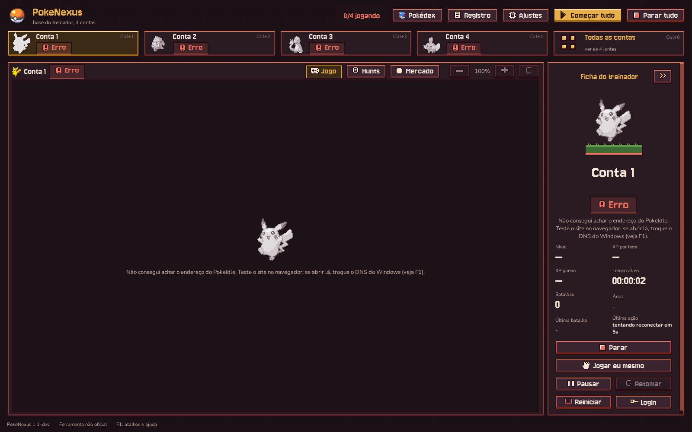
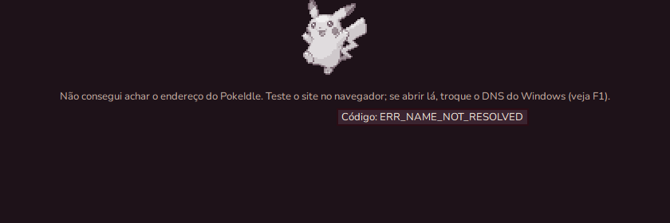
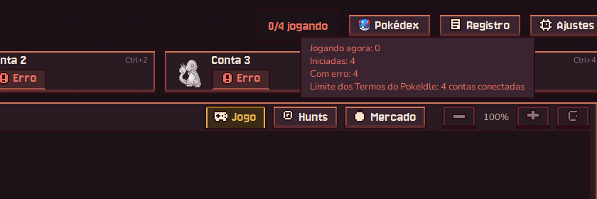
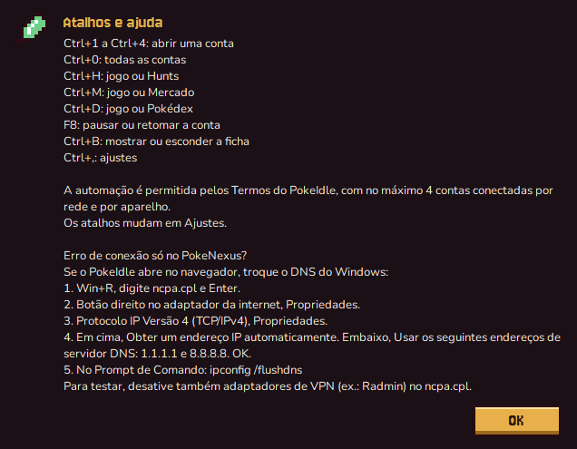
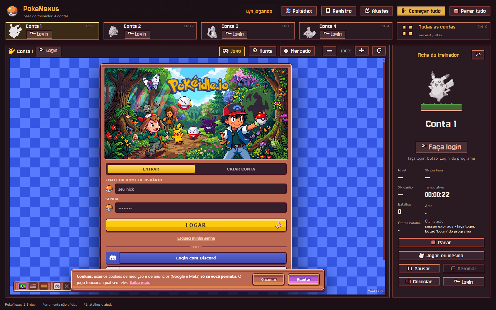
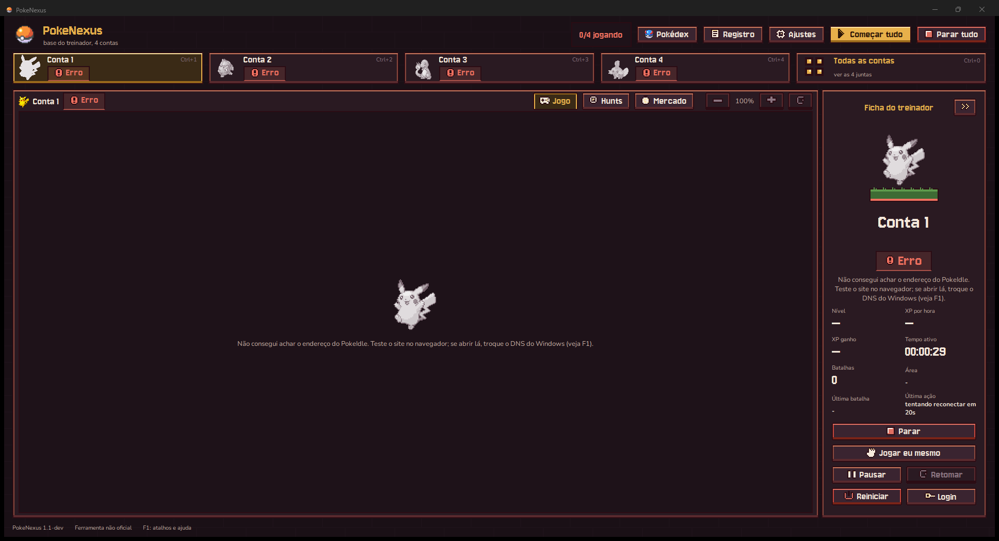

# Rede: DNS seguro, erros em português e contador honesto (22/10/2026)

## O problema

Um amigo do usuário via `ERR_NAME_NOT_RESOLVED` nas contas do PokeNexus, mas o PokeIdle abria no navegador
dele. O texto técnico do Chromium aparecia cru na tela, e o topo mostrava "4/4 conectadas" com as quatro
contas em erro.

## Causa

O navegador embutido (Qt WebEngine, Chromium) pergunta o endereço do site ao **DNS do Windows**
(`getaddrinfo`; o Qt6WebEngineCore.dll importa só essa função). Quando esse DNS não acha o `pokeidle.io`,
a página nem começa a carregar. Isso acontece, por exemplo, com o DNS do provedor, com um adaptador de VPN
(como o Radmin) passando na frente, ou com um bloqueio por nome. O navegador comum continua abrindo porque
costuma usar o próprio DNS seguro. Não deu para ver o PC do amigo, então essa é a causa mais provável, e é
a única que dá exatamente esse sintoma.

## O que mudou

| Onde | O quê |
|---|---|
| `browser/web_host.py` | `configurar_dns()`, chamada em `setup_environment()` antes do `QApplication` e de qualquer perfil: `QWebEngineGlobalSettings.setDnsMode` com `SecureWithFallback` e os servidores `https://cloudflare-dns.com/dns-query` e `https://dns.google/dns-query`. Vale para os 4 perfis e para a página de dados do Hunt/Pokédex. Se a função não existir, fica o DNS do Windows, como antes. |
| `app/erros_rede.py` (novo, sem Qt) | `traduzir(texto)` devolve a frase em português e a dica com o código (`Código: ERR_...`). Texto sem código de rede volta igual. |
| `app/gui.py` | O Placeholder (lugar do jogo) e a ficha da conta mostram a frase traduzida, com o código na dica. O worker e o log não mudam. O contador do topo mostra **"N/4 jogando"**; a dica traz jogando, iniciadas, com erro, esperando o login e o limite dos Termos. O F1 ganhou o item "Erro de conexão só no PokeNexus?". |
| `app/atualizacao.py` | Se o DNS do Windows não acha o GitHub, `_abrir` repete o pedido perguntando o endereço ao DNS seguro pelo IP (`https://1.1.1.1/dns-query`, depois `https://8.8.8.8/resolve`), com o certificado conferido pelo nome do host. Usa só a biblioteca padrão. |

Não mudaram: `workers/`, `game/`, `rmt/`, `hunts/`, `browser/cdp.py`, a lógica do `app/manager.py` e os
padrões do `config.toml`. O limite de 4 contas continua em `Manager.connected_count` e `can_connect`, que
contam as contas **iniciadas**.

### API usada

PySide6 **6.12.0** (Qt 6.12.0), conferida com `dir()`:

```
QWebEngineGlobalSettings: DnsMode, SecureDnsMode, setDnsMode
DnsMode: secureMode, serverTemplates
SecureDnsMode: SecureOnly, SecureWithFallback, SystemOnly
setDnsMode(modo) -> True
```

### Frases na tela

| Código | Frase |
|---|---|
| `ERR_NAME_NOT_RESOLVED` | Não consegui achar o endereço do PokeIdle. Teste o site no navegador; se abrir lá, troque o DNS do Windows (veja F1). |
| `ERR_INTERNET_DISCONNECTED` | Sem internet. |
| `ERR_CONNECTION_TIMED_OUT`, `_RESET`, `_REFUSED`, `ERR_ADDRESS_UNREACHABLE`, qualquer outro | Não consegui falar com o PokeIdle. Pode ser a internet ou o site fora do ar. |
| `ERR_PROXY_*` | Um proxy do Windows está bloqueando a conexão. |
| `ERR_CERT_*` | A conexão segura com o PokeIdle falhou (data e hora do PC certas?). |

## Como o modo "com volta" se comporta (medido)

O Chromium só testa os servidores de DNS seguro **uns 5 s depois de abrir**. O que for consultado antes
disso vai pelo DNS do Windows; depois, o DNS seguro é tentado primeiro e o do Windows fica de reserva. No
PC do amigo, a primeira tentativa de cada conta ainda pode dar erro nos primeiros segundos, e a nova
tentativa automática (5 s depois) já passa pelo DNS seguro. Foi o que o teste "DNS do Windows quebrado"
mostrou (abaixo).

Limite conhecido: os nomes dos servidores (`cloudflare-dns.com`, `dns.google`) são achados pelo DNS do
Windows. Se esse DNS não funcionar para **nenhum** nome, o DNS seguro não sobe, e aí vale o passo a passo
do F1.

## Testes

Todos com `POKENEXUS_DATA` numa pasta temporária: as contas ficam na tela de login e nenhuma conta real é
tocada. A rede do PC não foi mexida. As falhas de DNS foram simuladas **só dentro do processo de teste**.

1. **Tradução** (`ferramentas/rede/teste_erros.py`): 25 casos, TUDO OK.
2. **Erro na tela** (`ferramentas/rede/tela_erro.py --sem-dns`, com
   `QTWEBENGINE_CHROMIUM_FLAGS=--host-resolver-rules="MAP pokeidle.io ~NOTFOUND"`):
   - as 4 contas em ERRO, com a frase em português no lugar do jogo e na ficha;
   - dica `Código: ERR_NAME_NOT_RESOLVED`;
   - o log com o texto original (`falha ao abrir https://pokeidle.io/app: net::ERR_NAME_NOT_RESOLVED`) e nenhuma linha com a frase traduzida;
   - topo "0/4 jogando".

   
   
   
   
3. **DNS seguro no registro de rede** (`--log-net-log`):
   - Versão nova: `DNS_CONFIG_CHANGED` com `secure_dns_mode: Automatic` e os dois servidores, mais 20 pedidos `DOH_URL_REQUEST` (sondagens). A versão de antes não tem nenhum.
   - `ferramentas/rede/doh_netlog.py`, em "SecureOnly" (só para o teste): o PokeIdle abre **só** pelo DNS seguro, com pedidos para `pokeidle.io`, `challenges.cloudflare.com` e `static.cloudflareinsights.com`.
   - No modo do programa, um nome novo aberto 12 s depois (`example.com`) foi pelo DNS seguro.
   - **Com DNS normal as contas abrem como antes**: tela de login do jogo em 16,9 s a 17,0 s, contra 16,1 s e 16,6 s no código de antes (mesma máquina, variação normal).

   
4. **Caso do amigo de ponta a ponta** (`ferramentas/rede/dns_quebrado.py`): o `getaddrinfo` do Windows, só
   neste processo, responde "não encontrado" para `*.pokeidle.io`.

   | Código | Resultado |
   |---|---|
   | De antes | ERRO os 60 s inteiros (16 recusas). |
   | Novo | Erro aos 3 s; na nova tentativa (8 s) não houve mais nenhuma recusa, e as contas carregaram o jogo pelo DNS seguro. |

   O gancho de teste deixa o carregamento lento (controle sem recusar nada: 79 s), por isso esse teste não
   mede tempo.
5. **Contador e limite** (4 contas de teste em erro):
   - "0/4 jogando", com a dica "Iniciadas: 4, Com erro: 4";
   - com o limite em 3 (como em Ajustes), a 4ª foi recusada ("Já há 3 contas conectadas..."); com o limite em 4, aceita;
   - um `config.toml` com 5 contas e `max_simultaneas = 5` abre só 4 contas e limite 4.
6. **Regressão:**
   - `ferramentas/interface/atalhos.py` no código de antes e no novo dá o mesmo resultado em Ctrl+1…4, Ctrl+0, grade/celulares, Ctrl+H, Ctrl+M, Ctrl+B, F8, Ajustes, F1 e Parar tudo: mesma conta, modo, área, ficha e diálogos. Só o status do instante muda, conforme a página carregou.
   - Página de dados do Hunt/Pokédex: jogo 1.345.4, 1315 espécies.
   - Mercado + calculadora e Pokédex (`fechar_no_x.py`): fecham no X com código 0, sem processo sobrando.
7. **Atualizador** (`ferramentas/atualizacao/teste_doh.py`, DNS do Windows "quebrado" só no processo): 11 casos, TUDO OK.
   - Release v1.1.8 lida pela volta.
   - SHA256SUMS baixado com o redirecionamento do GitHub.
   - Erro HTTP continua erro HTTP.
   - Com o DNS normal, o DNS seguro não é usado.
8. **Pacote** (`ferramentas/rede/teste_build.ps1`, ZIP descompactado numa pasta nova, sem Python no PATH):
   - DNS normal: "0/4 jogando" e contas na tela de login; o registro de rede mostra o DNS seguro configurado e as consultas feitas depois das sondagens indo por ele (`hagen.challenges.cloudflare.com`).
   - DNS simulado fora: a frase em português na tela, 24 linhas do log com o código original e nenhuma com a frase.
   - Nos dois casos fechou no X com código 0, sem processo sobrando e sem `crash.log`.

   

## Decisão do 2.4 (atualizador)

**Feito**, sem dependência nova (cerca de 40 linhas com `urllib`, `http.client` e `socket`, mais o teste).
O 8.8.8.8 entrou como segunda opção por um motivo medido: o certificado do 1.1.1.1 vem da raiz da SSL.com, e
o Python só confia nas raízes que o Windows já baixou. Neste PC, a primeira chamada falhou com
`CERTIFICATE_VERIFY_FAILED` até o Windows baixar essa raiz. O 8.8.8.8 usa outra raiz (Google Trust
Services).

**Atenção:** a volta só existe a partir desta versão. Se o DNS do amigo também não acha o GitHub (é provável
que o aviso de atualização não tenha aparecido para ele por isso), ele precisa instalar esta versão **à mão
uma vez**. Depois disso o aviso dele passa a funcionar mesmo com esse DNS.

## Para o amigo testar

Arquivo `dist_novo\PokeNexus-dns-teste.zip` (versão `1.1-dev`, sem aviso de atualização). O passo a passo:

1. Feche o PokeNexus instalado (a mesma conta aberta em dois lugares derruba a sessão).
2. Descompacte o ZIP numa pasta nova e abra o `PokeNexus.exe` de dentro dela. Ele usa os mesmos logins.
3. Clique em **Começar tudo** e espere uns 15 s. Se aparecer "Não consegui achar o endereço do PokeIdle"
   e depois de alguns segundos o jogo carregar, a correção funcionou. Se a frase continuar, siga o F1
   (trocar o DNS do Windows).
